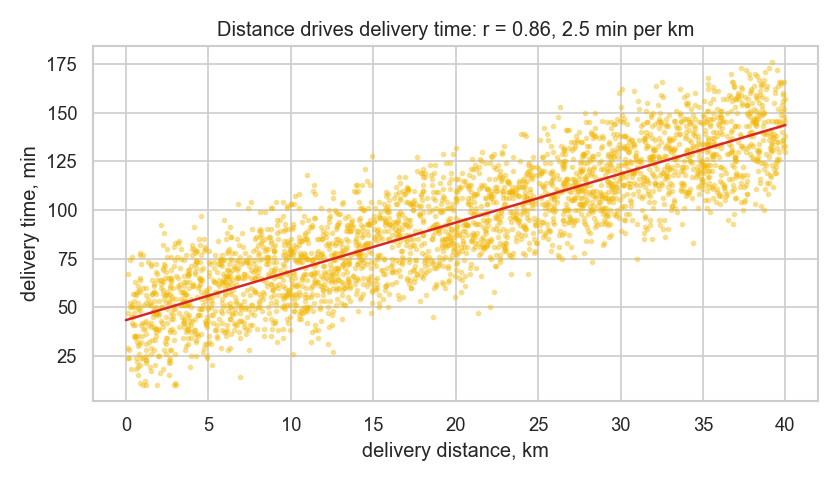
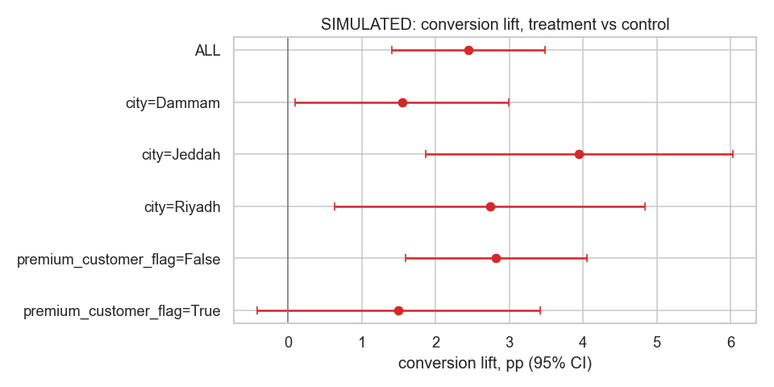

# Food Delivery Product Analytics

An end-to-end food-delivery product analytics project built with **Python, SQL, PostgreSQL, DuckDB and Streamlit**. It combines product funnel analysis, customer lifecycle insights, unit-economics scenarios, delivery and capacity analytics, experimentation, data-quality checks and interactive dashboards.

**An independent portfolio project using synthetic data, not internal company data.** The supplied dataset pack attributes its base to Kaggle's *Food Delivery Operations and Customer Analytics* (deepeshkansotia), a realistic synthetic dataset. Source attribution comes from the supplied pack; no source licence or redistribution permission was supplied. Resolve that before publishing the bundled data publicly. Saudi cities, dates, IDs and app events were generated; A/B effects are simulated.

## Business question

What drives orders, GMV, delivery performance and repeat usage across Riyadh, Jeddah and Dammam? Would reducing a free-delivery threshold from SAR 75 to SAR 50 improve conversion?

## Verified headline results

| Metric | Result | Definition |
|---|---:|---|
| Orders | 15,000 | All orders placed |
| Delivered | 12,997 | Not cancelled |
| Customers | 7,309 | Seeded IDs |
| GMV | SAR 5,797,900.58 | Final amount paid, delivered only; before refund adjustment |
| AOV | SAR 446.10 | Delivered GMV / delivered orders |
| Cancellation | 13.35% | 2,003 / 15,000 |
| On-time | 90.51% | Not source-flagged late, delivered only |
| Avg delivery | 93.88 min | Delivered only (94.14 over all orders) |
| Repeat customer rate | 60.73% | Customers with >1 order / all customers |
| Month-3 retention | 12.81% | Weighted eligible cohorts, January-September |

Money was converted from source USD to SAR at **3.75**, rounded to two decimals. Every source basket is at least USD 100, and 59.74% equal that floor. **SAR 446 is not a typical Saudi food-delivery basket.** City tiers map literally: 1 Riyadh, 2 Jeddah, 3 Dammam; Dammam therefore has the most orders (7,520).

## Findings and next steps

- Premium AOV is SAR 481.87 vs regular SAR 431.97 (+11.55%): test upgrade offers on frequency, not just basket.
- Distance correlates with delivery time at r = 0.86, preparation r = 0.39: investigate long-radius orders and kitchen prep.
- 47.77% miss their ETA but only 9.47% are flagged late: agree an SLA definition with Logistics.
- Promo-code AOV is SAR 445.78 vs SAR 446.32 without (p = .75): no evidence of basket lift; test reactivation instead.
- August GMV SAR 498,020.77 vs April SAR 469,838.34: a 6% spread, no strong seasonality in the synthetic base.

Nine quantified findings with interpretations and next steps are in [reports/findings.csv](reports/findings.csv).



## A/B readout: observed vs simulated

The smallest basket is SAR 375: all orders qualify under both SAR 50 and SAR 75, and source delivery fees were never adjusted. The observed data is therefore an **A/A test**, not evidence that changing the threshold works.

| Readout | Conversion lift | 95% CI | p | Verdict |
|---|---:|---:|---:|---|
| Observed A/A | -0.55 pp | -1.64 to +0.54 pp | .321 | REVISE AND RETEST |
| Simulated +3 pp over treatment baseline | +2.44 pp vs control | +1.41 to +3.48 pp | <.001 | Demonstration LAUNCH |

Customer-level robustness lift +2.30 pp, p < .001. SRM p = .2107 (3,601 control / 3,708 treatment). Simulated revenue per user +SAR 18.03 is **not significant** (CI -5.42 to +41.47, p = .132). Delivery time +0.29 min (p = .619), late rate +0.48 pp (p = .346). Cancellation mirrors conversion and is not an independent guardrail.

Simulation randomly converts 228 treatment cancellations to deliveries (seed 42), without changing any source file. Guardrail non-significance is not proof of non-inferiority; the demo launch rule is not a production recommendation. See [design and limitations](docs/experiment_design.md), [full results](reports/ab_results.csv), and [8-slide launch deck](reports/launch_deck.pptx).



## Run locally (Windows, Python 3.11 recommended)

From this project folder, with uv installed:

```powershell
uv venv --python 3.11 .venv
uv pip install --python .venv/Scripts/python.exe -r requirements.txt
.venv\Scripts\python.exe -m scripts.run_sql
.venv\Scripts\python.exe -m pytest -q
.venv\Scripts\python.exe -m streamlit run dashboard/app.py
```

Or create a Python 3.11 virtual environment and install dependencies with `python -m pip install -r requirements.txt`. On macOS/Linux, substitute `.venv/bin/python` for the Windows interpreter path.

Open http://127.0.0.1:8501 in your browser. The original four tabs remain: Executive, Growth, Delivery and Operations, Experiment. Six additional analytical pages cover Product Funnel, Unit Economics, Customer Lifecycle, Delivery Risk, Capacity Scenario and Experiment Design; the latest additions are Restaurant Performance and Data Quality Monitoring. The original executive dashboard supports city, month and customer-type filters and a filtered-order CSV export. Supporting pages include their own filters where relevant, metric explanations and CSV exports. The experiment's observed scorecard follows filters; inferential tables explicitly stay full-sample to avoid post-hoc peeking.

### Notebook

```powershell
.venv\Scripts\python.exe -m jupyter notebook
```

Open [notebooks/food_delivery_product_analytics.ipynb](notebooks/food_delivery_product_analytics.ipynb) and select this venv's kernel. Paths are relative to the notebook directory. Restart and Run All: **139 cells, 86 code cells**, seven embedded/saved charts. To re-execute from the project root:

```powershell
.venv\Scripts\python.exe -m jupyter nbconvert --to notebook --execute --inplace --ExecutePreprocessor.timeout=300 notebooks/food_delivery_product_analytics.ipynb
```

Run `scripts.run_sql` before the notebook: it produces the SQL parity report the notebook reads. The notebook produces DQ, KPI, findings and A/B reports consumed by the app.

### SQL and actual execution status

Seven numbered analyses in each dialect: quality, scorecard, funnel, growth, delivery, retention, A/B scorecard.

| Dialect | What was verified |
|---|---|
| BigQuery | Seven files executed in DuckDB with COUNTIF, SAFE_DIVIDE, JSON_VALUE shims and a FLOAT64 alias; not live BigQuery |
| PostgreSQL | Real local PostgreSQL 16.2; 15,000 orders and 60,000 events loaded; seven files executed |
| Redshift | SELECT query bodies executed in PostgreSQL with matching results; DDL/COPY templates not executed on Redshift |

[Parity evidence](reports/sql_outputs/parity.csv) and all 21 output tables are saved. The runner resets only this project's `food_delivery` database tables in the server stored under your home `.pg_food_delivery` directory; don't use that database for other work.

Manual PostgreSQL: create database food_delivery, run sql/postgres/00_schema.sql, and load via the runner's COPY FROM STDIN route. The 41-column table matches the CSV; the supplied guide's 10-column schema does not. Events retain a JSON payload.

Redshift-oriented schema and query files are included under `sql/redshift/` for review and future deployment in a compatible warehouse environment.

## Files and verification

- `data/raw/food_delivery.csv`: unchanged supplied source, 15,000 x 30.
- `data/processed/`: supplied 41-column Saudi orders and events; notebook-generated mapping and empty quarantine log.
- `notebooks/`: executed exploratory analysis, conversion checks, quality, growth, delivery, retention, simulation and statistics.
- `reports/`: additive monthly KPIs, DQ, nine findings, A/B results, seven PNGs, SQL outputs and slide deck.
- `sql/`: 7 analyses x 3 dialects plus PostgreSQL/Redshift schema/load templates.
- `tests/`: Automated tests cover data, currency conversion, event sequences, SQL parity, dashboard filters and page contracts, funnel generation, unit economics, customer lifecycle, experiment utilities, capacity scenarios and production-event validation.
- [Data dictionary](docs/data_dictionary.md).

Local verification covers the automated test suite, PostgreSQL query execution, Streamlit AppTest and notebook execution. Dashboard filter behavior is covered by automated tests; visual review of every chart is an ongoing quality-improvement area.

## Honest limitations

Seeded dates agree with source month but not source weekday. Every restaurant has orders across all three cities, irrespective of its name; restaurant ranking therefore excludes city. Customer IDs are randomly generated, and the flat cohort curve is not evidence of real retention. Events always start with a completed browse/cart/checkout chain, so no pre-checkout conversion can be estimated. The supplied notes incorrectly attribute all 150 missing tips/ratings to cancellation: only 19 are cancelled. Keep nulls; do not fill zero. Refunds are counted, not deducted from GMV, because refund amounts are absent.

Public publishing remains subject to confirming the source dataset's redistribution rights.

## Product analytics extensions (new branch)

This improvement branch adds an additive, local analytics layer without replacing the original analysis:

- Session-level event generator and funnel summary: `python -m scripts.build_product_sessions` then `python -m scripts.analyze_product_funnel`.
- Scenario unit economics: `python -m scripts.build_unit_economics`. Assumptions live in `config/unit_economics_assumptions.json`; outputs are illustrative and are not actual profit.
- Customer recency/frequency and cohort descriptors: `python -m scripts.build_customer_lifecycle`.
- Retrospective delivery ETA exception queue: `python -m scripts.build_delivery_risk`.
- Run all additive outputs in order: `python -m scripts.run_product_analytics`.
- New Streamlit pages are under `dashboard/pages/`; the original four-tab dashboard remains intact.
- CI workflow: `.github/workflows/analytics-ci.yml`.
- Experiment design requirements: [docs/EXPERIMENTATION_PLAYBOOK.md](docs/EXPERIMENTATION_PLAYBOOK.md).

The CI workflow automates the test suite, end-to-end analytics runner and Python compilation for the demonstration pipeline.

The generated non-purchasing sessions are synthetic demonstrations, not measured customer behaviour. Unit-economics outputs use explicit placeholder assumptions and must not be represented as finance actuals. Customer segments are descriptive, not a validated churn model. Delivery exceptions are retrospective and not live dispatch alerts.


## Production customer-event ingestion

The project includes a privacy-conscious event schema, CSV template and validation script to prepare an anonymised product-event export for analysis. This is an ingestion-ready contract; it does **not** mean a production event source is connected or that production customer data is present.

- [Production event schema](config/production_event_schema.json)
- [CSV template](data/templates/production_events_template.csv)
- [Validator](scripts/validate_production_events.py)

Validate an authorised, anonymised export stored outside the repository:

```bash
python -m scripts.validate_production_events --input /secure/path/events_export.csv
```

The validator checks the required event fields, event names, timestamps, duplicate event identifiers and JSON properties. Invalid rows are quarantined for review. Keep real customer data out of Git, screenshots and public issue comments. The existing demonstration funnel remains explicitly synthetic until a genuine event export and tracking definitions are supplied.

## Dashboard pages and operational analytics

Generate the local analytics outputs before starting the dashboard:

```bash
python -m scripts.run_product_analytics
streamlit run dashboard/app.py
```

The Streamlit dashboard is the primary BI deliverable. It preserves the original Executive, Growth, Delivery and Experiment views and adds:

- Product Funnel
- Unit Economics
- Customer Lifecycle
- Delivery Risk
- Capacity Scenario
- Experiment Design
- Restaurant Performance
- Data Quality Monitoring

The dashboard provides analytical views, metric context and CSV exports where applicable. Restaurant identifiers and their city relationships are seeded demonstration values. The data-quality page recalculates checks against the local dataset; it is not a continuously running production monitor. Funnel sessions, financial assumptions and rider-capacity inputs are labelled synthetic or illustrative wherever they are used.

Public dashboard hosting is optional. Before publishing, confirm the source dataset's redistribution rights and ensure no private or customer-level information is included.

## SQL engineering and validation

The project demonstrates multi-dialect SQL analysis and reproducible local validation.

- **PostgreSQL:** the warehouse queries are executed against a local PostgreSQL 16 instance.
- **BigQuery dialect:** the BigQuery-style queries are exercised locally in DuckDB with compatibility helpers.
- **Redshift dialect:** the Redshift query-port is compared locally through PostgreSQL. This checks query logic and result parity for the supported query bodies; it is **not** a live Amazon Redshift service test.

Together, these checks provide reproducible SQL validation across the supported dialect implementations.
